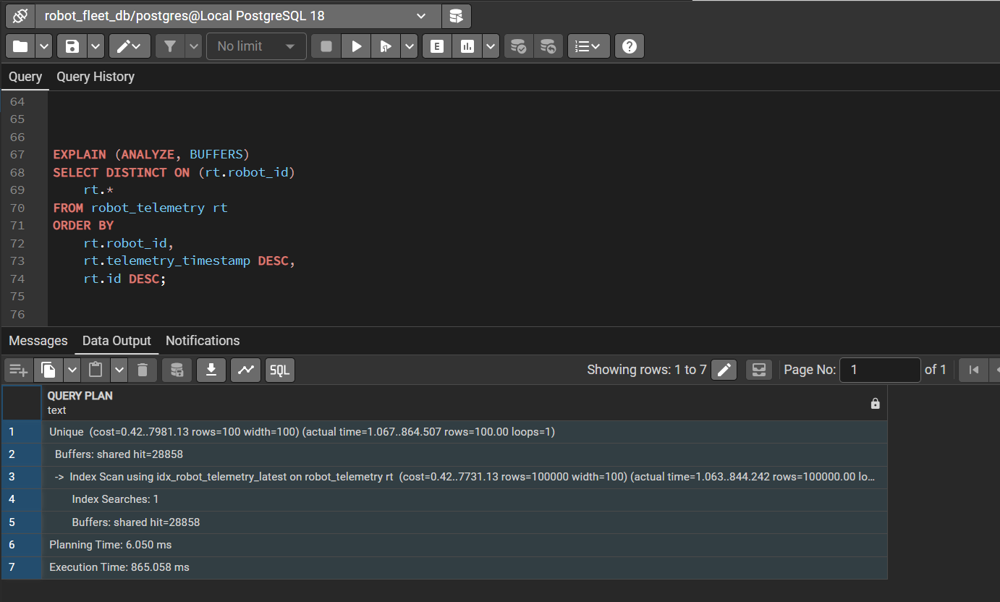
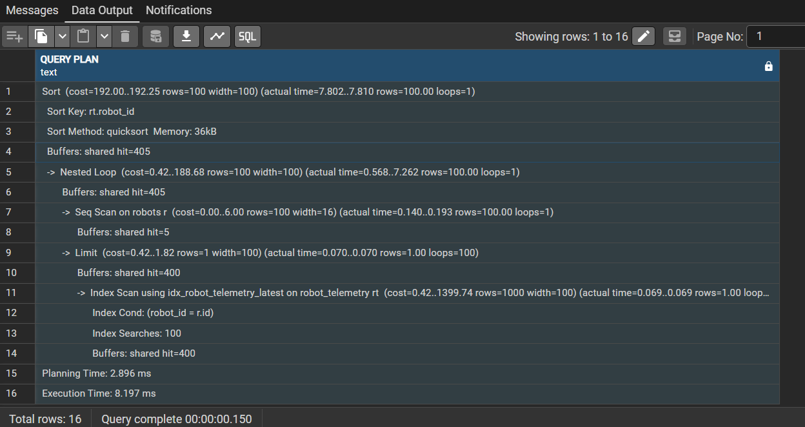

# Database Performance Analysis

## 1. Performance Test Dataset

The database performance test was conducted using the following dataset:

| Entity | Number of Records |
|---|---:|
| Robots | 100 |
| Robot Telemetry | 100,000 |
| Missions | 10,000 |

## 2. Query Performance Demonstration

PostgreSQL `EXPLAIN ANALYZE` was used to examine query execution plans and measure actual execution time.

### 2.1 Previous Query: DISTINCT ON

The previous implementation used PostgreSQL `DISTINCT ON` to retrieve the latest telemetry record for each robot.

**Recorded execution time: 2705.671 ms**

The execution plan showed:

- An index scan over 100,000 telemetry records.
- A Unique operation to select the latest record for each robot.
- Approximately 28,858 shared buffer hits.

### 2.2 Optimized Query: CROSS JOIN LATERAL

The optimized implementation uses `CROSS JOIN LATERAL` with `LIMIT 1` to retrieve the latest telemetry record for each robot.

**Recorded execution results:**

- Planning Time: **2.896 ms**
- Execution Time: **8.197 ms**

The execution plan showed:

- Sequential scan of 100 robot records.
- 100 indexed lookups in the telemetry table.
- One latest telemetry record retrieved per robot.
- Index Scan using `idx_robot_telemetry_latest`.
- 100 index searches.
- Avoidance of scanning the entire telemetry history.

### 2.3 Performance Comparison

| Implementation | Execution Time |
|---|---:|
| DISTINCT ON | 2705.671 ms |
| CROSS JOIN LATERAL | 8.197 ms |

The optimized query was approximately **330 times faster** in the recorded comparison.

Planning Time represents the time PostgreSQL takes to prepare the execution plan. Execution Time represents the time taken to execute the query.

## 3. Indexing Strategy

Indexes were designed according to frequently executed queries, particularly latest telemetry retrieval, mission assignment, historical record retrieval, and idempotency checks.

### 3.1 Latest Telemetry Composite Index

The following composite index was created through a Flyway database migration:

```sql
CREATE INDEX idx_robot_telemetry_latest
ON robot_telemetry (
    robot_id,
    telemetry_timestamp DESC,
    id DESC
);
```

**Index purpose:**

- `robot_id`: Efficiently locates telemetry belonging to a particular robot.
- `telemetry_timestamp DESC`: Prioritizes the newest telemetry record.
- `id DESC`: Provides deterministic ordering when timestamps are equal.

The index supports the latest telemetry API by allowing PostgreSQL to retrieve the newest telemetry record for each robot efficiently.

### 3.2 Other Important Database Indexes

The database also uses indexes and unique constraints to support frequently executed queries and maintain data consistency.

**Primary key indexes**

PostgreSQL automatically creates unique indexes for primary keys across the database tables. These support efficient record identification.

**Mission indexes**

- `idx_missions_assigned_robot`: Supports queries involving missions assigned to a particular robot.
- `idx_missions_status`: Supports filtering missions by status.
- `idx_missions_priority`: Supports mission priority filtering.
- `idx_missions_created_at`: Supports chronological mission queries.

**Mission assignment indexes**

- `idx_mission_assignments_mission_history`: Supports retrieving assignment history for a mission.
- `idx_mission_assignments_robot_history`: Supports retrieving assignment history for a robot.
- `uq_active_mission_per_robot`: Prevents a robot from having multiple active missions in `ASSIGNED` or `IN_PROGRESS` status.
- `uq_active_assignment_per_mission`: Prevents multiple active assignment records for the same mission.
- `uq_active_assignment_per_robot`: Prevents multiple active assignment records for the same robot.

**Mission event indexes**

- `idx_mission_events_mission_id`: Supports retrieving events belonging to a mission.
- `idx_mission_events_changed_at`: Supports queries based on event timestamps.

**Heartbeat indexes**

- `idx_robot_heartbeats_robot_received_at`: Supports retrieving recent heartbeat records for a robot.
- `uq_robot_heartbeats_robot_sequence`: Prevents duplicate heartbeat sequence numbers for a robot.

**Idempotency uniqueness**

- `uq_idempotency_scope_key`: Enforces uniqueness of `(operation_scope, idempotency_key)` to prevent duplicate idempotency records for the same operation and key.

**Telemetry uniqueness**

- `uq_robot_telemetry_session_sequence`: Prevents duplicate telemetry sequence numbers within the same robot session.

These indexes and constraints were selected according to actual query patterns, historical data retrieval requirements, and concurrency-safety requirements. Unnecessary indexes are avoided to reduce storage and write-maintenance overhead.

## 4. Indexing Trade-offs

Indexes improve read performance, but they also introduce storage and write-maintenance costs.

### Advantages

- Faster SELECT queries.
- Efficient filtering and ordering.
- Reduced unnecessary telemetry history scanning.
- Faster latest telemetry retrieval.
- Database-level enforcement of uniqueness constraints.
- Improved retrieval of historical mission assignments and events.

### Disadvantages

- Requires additional disk storage.
- Adds overhead when inserting, updating, or deleting records.
- Requires index maintenance.
- Too many indexes can negatively affect write-heavy workloads.

For example, telemetry records are inserted frequently. Adding unnecessary indexes to `robot_telemetry` could increase telemetry ingestion overhead because each insert may require additional index updates.

The composite telemetry index was selected because the read-performance improvement for latest telemetry queries outweighs the additional storage and write-maintenance costs.

Unique indexes also introduce maintenance overhead when indexed values change or records enter or leave the indexed condition. However, they provide important protection against duplicate records and conflicting mission assignments.

## 5. Index Performance Validation

PostgreSQL `EXPLAIN ANALYZE` was used to validate the effectiveness of the indexing strategy.

The following aspects were examined:

- Whether PostgreSQL uses the intended index.
- Whether the query performs an index scan or an unnecessary sequential scan.
- Number of rows scanned and returned.
- Actual execution time.
- Shared buffer usage.

The execution plans were compared before and after optimization to verify the performance improvement rather than assuming that adding an index automatically improves query performance.

## 6. Conclusion

The performance test demonstrates that an appropriate composite index combined with an optimized PostgreSQL query significantly improves latest telemetry retrieval.

The optimized API retrieves the latest telemetry record for each robot without returning or scanning the entire telemetry history.

The indexing strategy balances query performance, database consistency, storage requirements, and telemetry write efficiency.

## 7. EXPLAIN ANALYZE Screenshots

### 7.1 Before Optimization – DISTINCT ON

The following execution plan shows the performance of the previous query implementation.



### 7.2 After Optimization – CROSS JOIN LATERAL

The following execution plan demonstrates the optimized execution plan using the composite index `idx_robot_telemetry_latest`.

