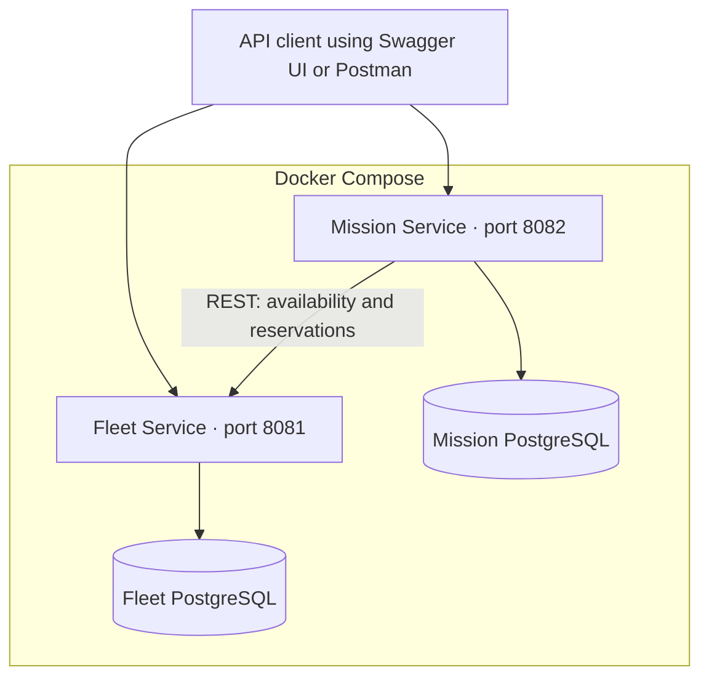

# Robot Fleet System Architecture

Docker Compose runs Fleet Service and Mission Service as separate Spring Boot applications. Each service owns its PostgreSQL database. Mission Service calls Fleet Service over REST to check robot availability and manage reservations.

- **Fleet Service** manages robots, telemetry, heartbeats, availability, and reservations.
- **Mission Service** manages mission creation, scheduling, lifecycle, execution events, and assignment history.