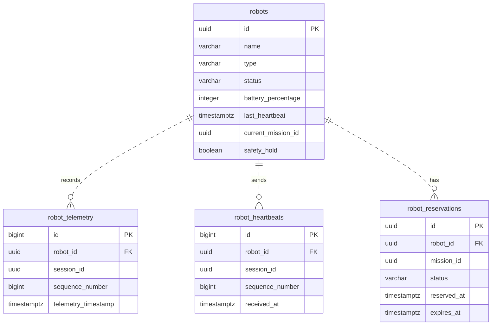
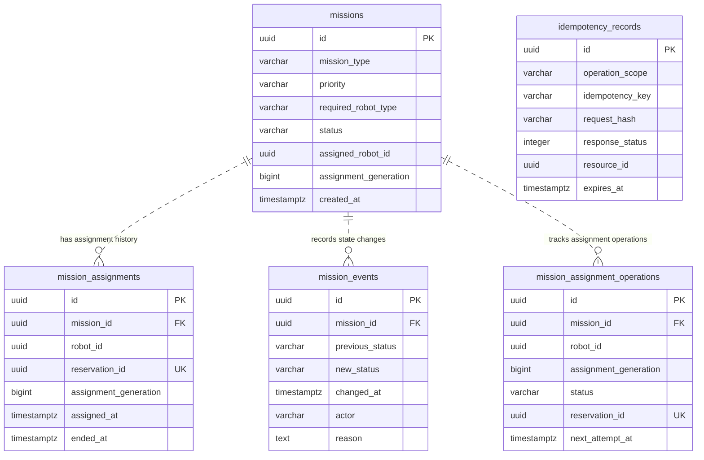

# Robot Fleet Database ER Diagram

## Fleet database

`robot_reservations.mission_id` and `robots.current_mission_id` are logical references to Mission Service records. Fleet Service and Mission Service each own a separate PostgreSQL database.

## Mission database

- `mission_id` references `missions.id` in the assignment, event, and operation tables.
- Robot and reservation IDs are logical references to resources owned by Fleet Service.
- The assignment and operation tables each enforce uniqueness on `(mission_id, assignment_generation)`.
- The idempotency table enforces uniqueness on `(operation_scope, idempotency_key)`.